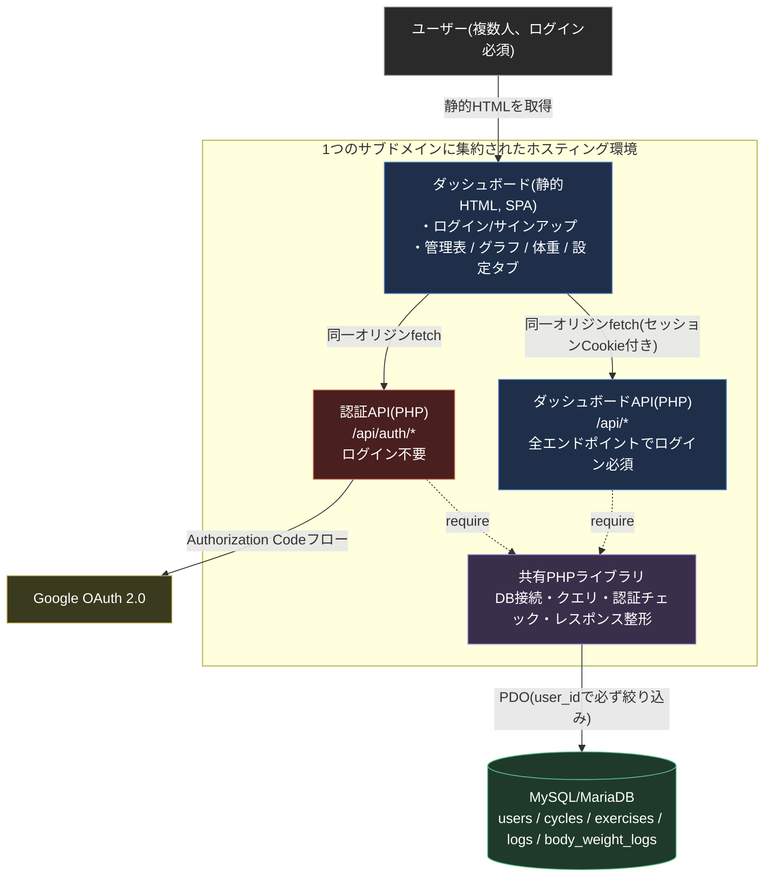

# たまちゃんの筋トレ管理

筋トレの記録入力・進捗確認を行うWebアプリ。npm workspacesによるモノリポ構成で、ログイン必須のダッシュボード(フロントエンド、TypeScript)とAPI(バックエンド、PHP)を1つのリポジトリで管理している。将来的に無料で一般公開し、複数のユーザーがそれぞれ自分の記録を管理できる製品として育てる方針。

## アーキテクチャ



設計判断の詳細(なぜこの構成にしたか)は [docs/architecture.md](docs/architecture.md)・[docs/design.md](docs/design.md) を参照。

## 技術スタック

| レイヤー | 技術 |
| :--- | :--- |
| フロントエンド | TypeScript + Vite(フレームワーク無し) |
| グラフ描画 | Chart.js |
| バックエンド | PHP(フレームワーク無し、PDO + プリペアドステートメント) |
| 認証 | セッションCookie、Google OAuth 2.0、メール/パスワード(bcrypt) |
| データベース | MySQL / MariaDB |
| モノリポ管理 | npm workspaces |
| フロントエンドテスト | Vitest + jsdom |
| バックエンドテスト | PHPUnit(Unit + Integration) |
| 静的解析 | ESLint + typescript-eslint / PHPStan + PHP_CodeSniffer(PSR-12) |
| CI | GitHub Actions |

## ディレクトリ構成

```
apps/
  dashboard/       ログイン必須のダッシュボード(管理表・グラフ・体重・設定タブ)
packages/
  shared/          型定義・ユーティリティ
php/
  private/         DB接続・共通クエリ・認証・バリデーション(Webから直接アクセス不可)
  api/             ダッシュボードAPI(全エンドポイントでログイン必須)
  api/auth/        認証API(サインアップ・ログイン・Google OAuth・パスワードリセット)
  tests/           PHPUnitテスト(Unit / Integration)
sql/
  schema.sql       テーブル定義
  seed.sql         ローカル開発・CI用の架空データ
docs/
  requirements.md / design.md / architecture.md  要件・設計の詳細ドキュメント
```

## ローカル開発

### フロントエンド

```bash
npm install
npm run dev --workspace=dashboard
```

認証まわり(セッションCookie)はダッシュボードとAPIが同一オリジンであることを前提にしているため、フロントエンドの単独起動(`npm run dev`)だけではログイン後の画面までは確認できない。実機での動作確認はデプロイ先での確認が必要。

### バックエンド(PHP)

```bash
composer install
cp php/private/.env.example php/private/.env   # DB接続情報・Google OAuth・メール送信設定を編集
```

ローカルにMySQL/MariaDBを用意し、`sql/schema.sql`・`sql/seed.sql`を流すと架空データで動作確認できる。`sql/seed.sql`は個人情報を含まない架空のトレーニングデータ。

## テスト

```bash
# フロントエンド(全workspace)
npm run test
npm run lint
npm run typecheck

# バックエンド
composer test          # PHPUnit(Unit + Integration)
composer run lint      # PHP_CodeSniffer(PSR-12)
composer run stan      # PHPStan
```

PHPUnitのIntegrationテストは実際のMySQL/MariaDBが必要(`DB_HOST`等の環境変数、または`php/private/.env`から接続情報を読む)。CIではMariaDBのサービスコンテナに対して実行している(`.github/workflows/ci.yml`)。

## デプロイについて

本番は共有ホスティング(XServer)上で稼働しており、SSH/Composerが使えないためCI/CDによる自動デプロイは組んでいない。ビルド成果物(`apps/dashboard/dist`)をFTPで手動アップロードする運用。CI自体は品質ゲート(lint・型チェック・テスト・ビルド確認)として独立して機能する。

## ライセンス

[MIT](LICENSE)
