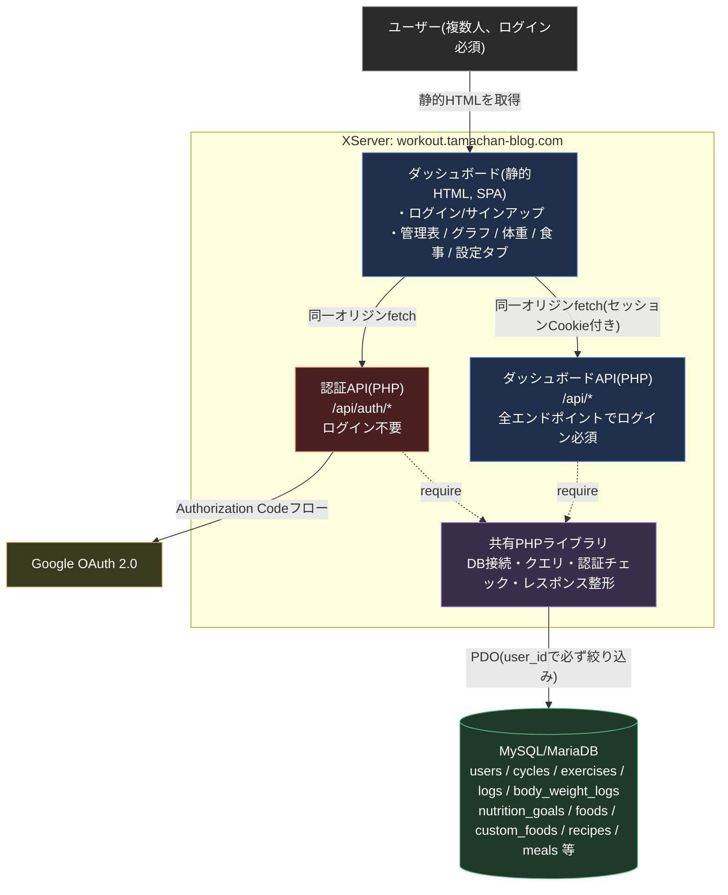
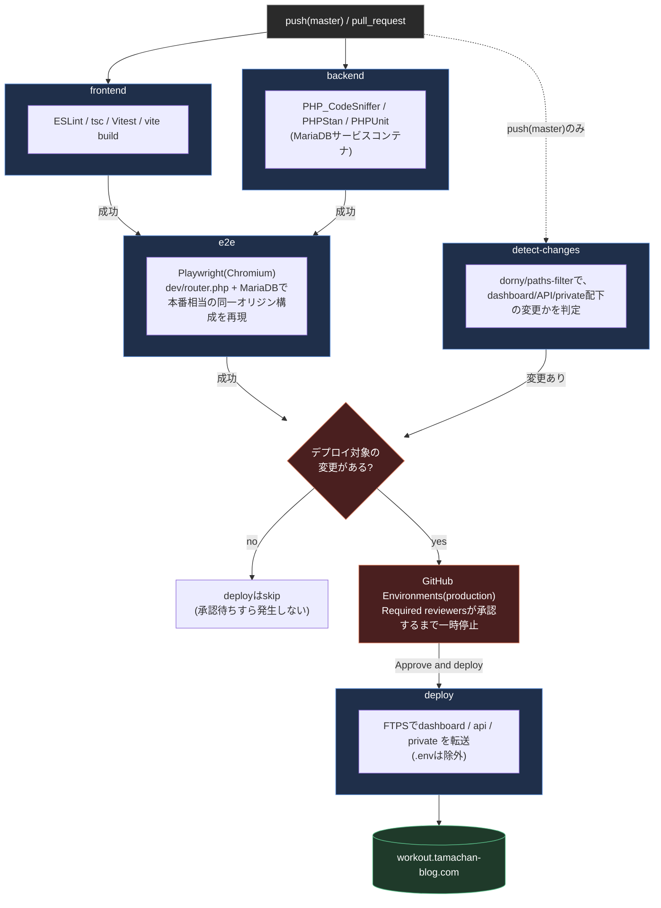

# たまちゃんの筋トレ管理 — アーキテクチャ

詳細な設計判断・データモデル・API仕様は [design.md](design.md) を参照。ここでは全体構成を図で示す。

ソースコードはGitHub(`github.com/tamatyan1111/workout`)で管理しているが、GitHub Pagesなどのホスティング機能は使わず、ビルド成果物をFTPSでXServerへ配置する形にしている(ソース管理とホスティングを分離)。配置自体はCI/CD(下記)で自動化している。

## ポイント

1. **ログイン必須の単一ダッシュボードに統合する** — 旧来の「誰でも見られる公開サイト」+「秘密パス配下の入力ページ」という2アプリ構成を廃止し、全機能をログイン後のダッシュボード1つに統合した(design.md §0.1・§1)。すべてのAPIが同一オリジン・ログイン必須になり、CORS設定も本番では不要になる
2. **ユーザーごとにデータを分離する** — `users`テーブルを新設し、`cycles`・`exercises`・`logs`・`body_weight_logs`の全テーブルに`user_id`を直接持たせる。APIは常にログイン中のユーザーでWHERE句を絞り込み、リクエストパラメータのユーザー指定は信用しない(design.md §1.2)
3. **サイクルはユーザーごとに自由に定義できる** — 旧設計は全ユーザー共通の固定4行(Push/Pull/Legs/Rest)だったが、ユーザーごとに作成・編集できるテーブルに変更した。初回ログイン時はテンプレートから選ぶか、ゼロから作ることができる(design.md §2.3・§2.7)
4. **単一の真実源** — 全APIは同じMySQL/MariaDBデータベースを、同じ共有PHPライブラリ経由で読み書きする。二重管理のロジックは無い
5. **書き込み時の再計算をしない** — 「現在値」はDBに保存せず、読み取り時にSQLで都度計算する(design.md §2.9)。これにより旧GAS版で繰り返し発生した再計算漏れ・誤上書きのバグを構造的に無くしている
6. **本番にComposerのvendor/をデプロイしない** — Googleログインのトークン検証も、JWT検証ライブラリを使わずGoogleの`userinfo`エンドポイントへのHTTPS呼び出しで済ませる方式にしている(design.md §1.1)

## 使用サービス

| 要素 | サービス | 費用 |
| :--- | :--- | :--- |
| ダッシュボード・データ保存・API実行環境 | XServer(スタンダードプラン、MySQL/MariaDB + PHP) | 既存契約内(追加費用なし) |
| メール送信(パスワードリセット等) | XServer標準プラン付属のメールアカウント機能 | 既存契約内(追加費用なし) |
| Googleログイン | Google Cloud の OAuth 2.0 クライアント | 無料枠 |
| ソースコード管理 | GitHub(ホスティングには使わない) | 無料 |
| フロントエンド | Vite + TypeScript | 無料 |
| グラフ描画 | Chart.js | 無料 |

## CI/CD

`.github/workflows/ci-cd.yml`。`master`へのPRマージをトリガーに、テスト・ビルド確認・本番デプロイまで一気通貫で行う。

**ポイント**:

- `frontend`・`backend`は並行実行、両方成功後に`e2e`が走る。`detect-changes`は`push(master)`の時だけ動く(PRの時点では判定不要なため)
- **承認ゲート**: `deploy`ジョブはGitHub Environments(`production`)の"Required reviewers"を使い、FTPS認証情報(Secrets)へのアクセス・実際の転送実行の直前で一時停止する。承認者(現状はたまちゃんさん本人)が「Approve and deploy」を押すまで実行されない。これは複数人開発になった場合の安全策で、マージ自体は誰でもできても、本番への書き込みは指定した承認者だけができる設計になっている
- **パスフィルター**: `detect-changes`が、実際にビルド成果物へ影響するパス(`apps/dashboard/src`・`public`・`index.html`・`vite.config.ts`・`packages/shared/src`・`php/api`・`php/private`)の変更かどうかを判定する。CI設定やdevDependencyだけの更新(Dependabotの`typescript`/`vitest`更新等)では、`deploy`は承認待ちにすらならずスキップされる
- **DBマイグレーション**: XServerはSSHが使えずGitHub ActionsからDBへ直接繋げないため、スキーマ変更は今後も手動(承認ボタンを押す前にphpMyAdminで`sql/migrate_*.sql`を実行しておく運用)
- 強制的にデプロイしたい場合(パスフィルターに関わらず)は、Actionsタブから`workflow_dispatch`で手動実行できる
- 依存パッケージの更新はDependabot(週次、npm/composer/github-actions)が自動でPRを作る。中身の確認・マージは人間(たまちゃんさん、または委任された私)が行う

## 過去のアーキテクチャからの変更

Google スプレッドシート + Apps Script → XServer(MySQL/PHP)、GitHub Pagesでの公開サイト分離 → 1サブドメインへの統合、秘密パス方式 → ログイン認証を伴うマルチユーザー化、という3段階の移行を経ている。移行の背景・技術的な理由の詳細は [design.md](design.md) §0・§0.1を参照。
