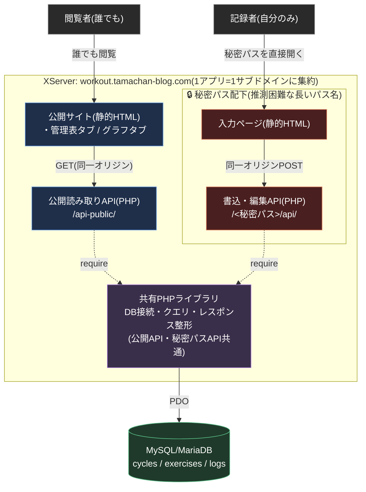

# たまちゃんの筋トレ管理 — アーキテクチャ

詳細な設計判断・データモデル・API仕様は [design.md](design.md) を参照。ここでは全体構成を図で示す。

ソースコードはGitHub(`github.com/tamatyan1111/workout`)で管理しているが、GitHub Pagesなどのホスティング機能は使わず、ビルド成果物をFTPでXServerへ配置する形にしている(ソース管理とホスティングを分離)。

## ポイント

1. **1アプリ=1サブドメインに統一する** — 公開サイト・公開API・秘密パスAPI・入力ページをすべて同じ1つのサブドメイン(`workout.tamachan-blog.com`)に集約する。当初は公開サイトをGitHub Pages(別ドメイン)でホストしていたが、ドメイン・リポジトリ名がバラバラで分かりにくくなったため統合した。すべて同一オリジンになったことで、公開読み取りAPI向けのCORS設定も本番では不要になった(design.md §1)
2. **サブドメイン名自体は秘密にしない** — 無料SSL証明書はCT(Certificate Transparency)ログに公開記録されるため、「入力ページ専用の秘密サブドメイン」を作るとサブドメイン名自体が`crt.sh`等で検索可能になり、秘密性が崩れる。代わりに、サブドメイン名は推測されてよい前提にし、その配下の長いランダムな「パス」だけで秘密性を確保する(design.md §1.1)
3. **単一の真実源** — 公開API・秘密パスAPIはどちらも同じMySQL/MariaDBデータベースを、同じ共有PHPライブラリ経由で読み書きする。二重管理のロジックは無い
4. **書き込み時の再計算をしない** — 「現在値」はDBに保存せず、読み取り時にSQLで都度計算する(design.md §2.5)。これにより旧GAS版で繰り返し発生した再計算漏れ・誤上書きのバグを構造的に無くしている
5. **認証なし** — 秘密パス(推測困難な長い文字列)だけが書き込みAPIの防御手段。OAuth等の本格的な認証は使わない(個人利用の小規模プロジェクトのため、design.md §1.2)。将来ログイン機能を足す場合に備え、秘密パスAPIの各エンドポイントは認証チェックを1行差し込むだけで済む構造にしてある

## 使用サービス

| 要素 | サービス | 費用 |
| :--- | :--- | :--- |
| 公開サイト・データ保存・API実行環境 | XServer(スタンダードプラン、MySQL/MariaDB + PHP) | 既存契約内(追加費用なし) |
| ソースコード管理 | GitHub(ホスティングには使わない) | 無料 |
| フロントエンド | Vite + TypeScript | 無料 |
| グラフ描画 | Chart.js | 無料 |

## 過去のアーキテクチャからの変更

1. **Google スプレッドシート + Google Apps Script → XServer(MySQL/PHP)**: Project A(読み取り専用)/ Project B(秘密URL書き込み用)で構築していたが、書き込み時の現在値再計算がスキーマ不一致で誤上書きする事故や、Apps Script特有の運用摩擦が繰り返し発生したため移行した(design.md §0)
2. **GitHub Pages(公開サイト)→ XServerに統合**: 移行直後は公開サイトのみGitHub Pagesでホストしていたが、ドメイン・リポジトリ名の系統がバラバラになる問題があり、「1アプリ=1サブドメイン」の方針でXServer側に統合した
