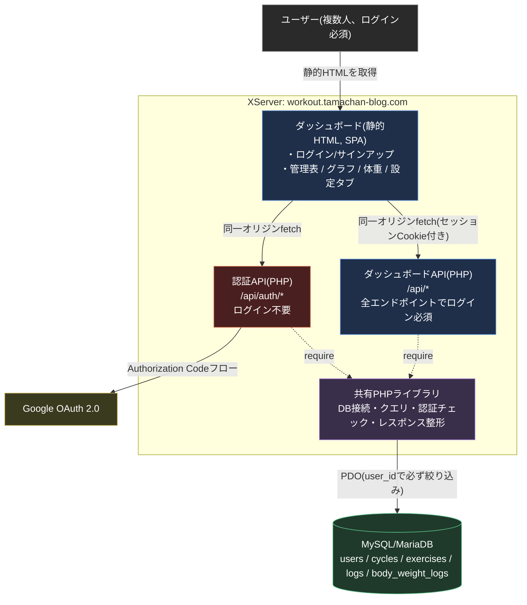

# たまちゃんの筋トレ管理 — アーキテクチャ

詳細な設計判断・データモデル・API仕様は [design.md](design.md) を参照。ここでは全体構成を図で示す。

ソースコードはGitHub(`github.com/tamatyan1111/workout`)で管理しているが、GitHub Pagesなどのホスティング機能は使わず、ビルド成果物をFTPでXServerへ配置する形にしている(ソース管理とホスティングを分離)。

## ポイント

1. **ログイン必須の単一ダッシュボードに統合する** — 旧来の「誰でも見られる公開サイト」+「秘密パス配下の入力ページ」という2アプリ構成を廃止し、全機能をログイン後のダッシュボード1つに統合した(design.md §0.1・§1)。すべてのAPIが同一オリジン・ログイン必須になり、CORS設定も本番では不要になる
2. **ユーザーごとにデータを分離する** — `users`テーブルを新設し、`cycles`・`exercises`・`logs`・`body_weight_logs`の全テーブルに`user_id`を直接持たせる。APIは常にログイン中のユーザーでWHERE句を絞り込み、リクエストパラメータのユーザー指定は信用しない(design.md §1.2)
3. **サイクルはユーザーごとに自由に定義できる** — 旧設計は全ユーザー共通の固定4行(Push/Pull/Legs/Rest)だったが、ユーザーごとに作成・編集できるテーブルに変更した。初回ログイン時はテンプレートから選ぶか、ゼロから作ることができる(design.md §2.3・§2.7)
4. **単一の真実源** — 全APIは同じMySQL/MariaDBデータベースを、同じ共有PHPライブラリ経由で読み書きする。二重管理のロジックは無い
5. **書き込み時の再計算をしない** — 「現在値」はDBに保存せず、読み取り時にSQLで都度計算する(design.md §2.9)。これにより旧GAS版で繰り返し発生した再計算漏れ・誤上書きのバグを構造的に無くしている
6. **本番にComposerのvendor/をデプロイしない** — Googleログインのトークン検証も、JWT検証ライブラリを使わずGoogleの`userinfo`エンドポイントへのHTTPS呼び出しで済ませる方式にしている(design.md §1.1)

## 使用サービス

| 要素 | サービス | 費用 |
| :--- | :--- | :--- |
| ダッシュボード・データ保存・API実行環境 | XServer(スタンダードプラン、MySQL/MariaDB + PHP) | 既存契約内(追加費用なし) |
| メール送信(パスワードリセット等) | XServer標準プラン付属のメールアカウント機能 | 既存契約内(追加費用なし) |
| Googleログイン | Google Cloud の OAuth 2.0 クライアント | 無料枠 |
| ソースコード管理 | GitHub(ホスティングには使わない) | 無料 |
| フロントエンド | Vite + TypeScript | 無料 |
| グラフ描画 | Chart.js | 無料 |

## 過去のアーキテクチャからの変更

1. **Google スプレッドシート + Google Apps Script → XServer(MySQL/PHP)**: Project A(読み取り専用)/ Project B(秘密URL書き込み用)で構築していたが、書き込み時の現在値再計算がスキーマ不一致で誤上書きする事故や、Apps Script特有の運用摩擦が繰り返し発生したため移行した(design.md §0)
2. **GitHub Pages(公開サイト)→ XServerに統合**: 移行直後は公開サイトのみGitHub Pagesでホストしていたが、ドメイン・リポジトリ名の系統がバラバラになる問題があり、「1アプリ=1サブドメイン」の方針でXServer側に統合した
3. **秘密パス方式 → ログイン認証を伴うマルチユーザー化(2026-08)**: 当初は自分専用ツールとして、推測困難な長いパスだけで書き込みを保護する設計だった。将来的に無料で一般公開し複数のユーザーが使える製品に育てる方針に転換したのに伴い、「誰でも見られる公開サイト」+「秘密パスの入力ページ」の2アプリ構成を廃止し、通常のログイン認証(Google / メールアドレス・パスワード)を伴う単一ダッシュボードに作り替えた。サイクル定義も全ユーザー共通の固定4行から、ユーザーごとに自由に設定できる形に変更した(design.md §0.1)
